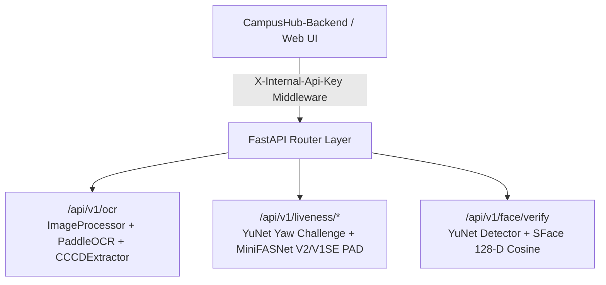

# CampusHub-OCR — Vietnamese CCCD OCR, Liveness & Face Verification Service

> Dịch vụ AI nội bộ xử lý trích xuất thông tin Căn cước công dân (CCCD) Việt Nam, kiểm tra thực thể sống hai lớp (Active Liveness + Passive Anti-Spoofing) và so khớp khuôn mặt 1:1 cho hệ sinh thái CampusHub.

[](https://github.com/canhhocit/CampusHub-OCR/actions/workflows/ci.yml)
[](https://www.python.org/)
[](https://fastapi.tiangolo.com/)
[](https://github.com/PaddlePaddle/PaddleOCR)
[](https://opencv.org/)

**Hệ sinh thái CampusHub:** [CampusHub-Frontend](https://github.com/canhhocit/CampusHub-Frontend) | [CampusHub-Backend](https://github.com/canhhocit/CampusHub-Backend) | **CampusHub-OCR**

---

## Mục lục

- [Tổng quan & Vai trò trong hệ thống](#tổng-quan--vai-trò-trong-hệ-thống)
- [Kiến trúc xử lý & Thành phần](#kiến-trúc-xử-lý--thành-phần)
- [Tech Stack & Mô hình sử dụng](#tech-stack--mô-hình-sử-dụng)
- [Cấu trúc thư mục](#cấu-trúc-thư-mục)
- [Cài đặt, Tải mô hình và Khởi chạy](#cài-đặt-tải-mô-hình-và-khởi-chạy)
- [Biến môi trường](#biến-môi-trường)
- [Tài liệu API](#tài-liệu-api)
- [Kiểm thử, Benchmark và CI](#kiểm-thử-benchmark-và-ci)
- [Triển khai Docker](#triển-khai-docker)
- [Nguyên tắc An toàn, Bảo mật và Giới hạn](#nguyên-tắc-an-toàn-bảo-mật-và-giới-hạn)

---

## Tổng quan & Vai trò trong hệ thống

**CampusHub-OCR** là microservice FastAPI chuyên trách xử lý ảnh và suy luận thị giác máy tính trên CPU, vừa hỗ trợ giao diện kiểm thử/benchmark độc lập (`GET /`), vừa phục vụ luồng eKYC của `CampusHub-Backend` qua giao thức REST nội bộ bảo vệ bằng `X-Internal-Api-Key`.

Dịch vụ tuân thủ 3 nguyên tắc cốt lõi:
- **Zero Disk Persistence:** Đọc và xử lý hình ảnh hoàn toàn trong RAM, không lưu ảnh CCCD hay dữ liệu sinh trắc học xuống đĩa máy chủ.
- **Fail-Closed:** Thiếu trọng số ONNX, lỗi suy luận hoặc phát hiện giả mạo đều từ chối xác thực tường minh, không âm thầm fallback sang mock ở runtime.
- **Tách biệt thẩm quyền:** Dịch vụ chỉ trả về dữ liệu trích xuất và điểm số kỹ thuật; quyền phê duyệt hay cấp trạng thái xác minh sinh viên thuộc toàn quyền nghiệp vụ của `CampusHub-Backend`.

---

## Kiến trúc xử lý & Thành phần



1. **Module OCR CCCD (`ocr_engine.py`, `cccd_extractor.py`, `image_processor.py`):**
   - Kiểm tra kích thước ảnh, định dạng thực bằng magic bytes (chỉ nhận JPG/JPEG/PNG tối đa `10 MB`) và tiền xử lý tương phản.
   - Nhận dạng tự động mặt thẻ (`AUTO`, `FRONT`, `BACK`), trích xuất có cấu trúc các trường mặt trước (số CCCD 12 chữ số, họ tên, ngày sinh, giới tính, quốc tịch, quê quán, thường trú, ngày hết hạn) và mặt sau (đặc điểm nhân dạng, ngày cấp, nơi cấp, MRZ).
2. **Module Kiểm tra Thực thể Sống Hai Lớp (`liveness_service.py`, `anti_spoofing_service.py`):**
   - **Active Pose Challenge:** Tạo phiên theo dõi thử thách quay đầu (`TURN_HEAD_LEFT`, `TURN_HEAD_RIGHT`), tính toán góc lệch Yaw từ 5 facial landmarks của YuNet và kiểm tra tỷ lệ khung hình khuôn mặt.
   - **Passive Anti-Spoofing (PAD):** Chạy song song 2 mô hình ONNX **MiniFASNetV2** (scale `2.7`) và **MiniFASNetV1SE** (scale `4.0`) qua OpenCV DNN để chống phát lại video (video replay) và ảnh in (print attack), phân loại rõ `LIVE`, `SPOOF`, `UNCERTAIN` hoặc `ERROR`.
3. **Module So khớp Khuôn mặt 1:1 (`face_verifier.py`):**
   - Tách khuôn mặt từ ảnh chân dung trên CCCD và ảnh selfie bằng **YuNet**, đánh giá chất lượng ảnh (độ mờ Laplacian, độ sáng, kích thước khuôn mặt), sau đó tính **Cosine Similarity** trên vector embedding 128 chiều của **SFace** (ngưỡng mặc định `0.363`).

---

## Tech Stack & Mô hình sử dụng

| Thành phần | Thư viện / Mô hình | Chi tiết |
|---|---|---|
| API & Schema | FastAPI `0.156.8`, Uvicorn `0.54.0`, Pydantic `2.14.1` | Middleware kiểm tra `X-Internal-Api-Key` & no-cache |
| OCR Engine | PaddleOCR `2.8.1` + PaddlePaddle `2.6.2` | Suy luận tiếng Việt trên CPU |
| Computer Vision | OpenCV `4.11.0.86`, Pillow `13.0.0`, NumPy `1.26.4` | Tiền xử lý & chạy ONNX qua `cv2.dnn` |
| Face Detection & Embedding | YuNet (`2023mar`) + SFace (`2021dec`) | OpenCV Zoo (Apache-2.0) |
| Passive Anti-Spoofing | MiniFASNetV2 (`2.7`) + MiniFASNetV1SE (`4.0`) | Silent-Face-Anti-Spoofing ONNX (Apache-2.0) |
| Kiểm thử & Benchmark | Pytest `9.1.1`, HTTPX `0.28.1`, RapidFuzz `3.14.6` | Unit, API mock tests & CER / FAR / FRR / PAD evaluation |

---

## Cấu trúc thư mục

```text
CampusHub-OCR/
├── .github/workflows/ci.yml        # GitHub Actions: compileall + pytest
├── Dockerfile                      # Python 3.11-slim + auto-download 4 ONNX models
├── requirements.txt                # Dependencies đã pin phiên bản
├── download_models.py              # Tải 4 ONNX models + xác thực SHA256 + smoke test
├── evaluate.py                     # Benchmark OCR (CER, Exact-Match, Latency)
├── evaluate_face.py                # Benchmark so khớp khuôn mặt (FAR, FRR)
├── evaluate_liveness_pad.py        # Benchmark PAD theo giao thức ISO/IEC 30107-3
├── docs/
│   └── liveness_evaluation_protocol.md
├── app/
│   ├── main.py                     # FastAPI app, API key middleware, CORS, static UI
│   ├── config.py                   # Cấu hình cổng, ngưỡng OCR/Face/Liveness/PAD
│   ├── api/                        # routes.py, face_routes.py, liveness_routes.py
│   ├── schemas/                    # ocr.py, face.py, liveness.py
│   ├── services/                   # ocr_engine, cccd_extractor, image_processor,
│   │                               # face_verifier, liveness_service, anti_spoofing_service
│   ├── static/                     # CSS & JS cho giao diện thử nghiệm cục bộ
│   └── templates/index.html        # Trang thử nghiệm tích hợp OCR + Face + Liveness
└── tests/
    ├── conftest.py                 # Mock fixtures & TestClient
    ├── fixtures/                   # Dữ liệu mẫu synthetic (không chứa ảnh CCCD thật)
    ├── generate_specimen_card.py   # Sinh thẻ mẫu phục vụ test
    ├── test_api.py                 # Endpoint /health, /ocr & bảo vệ OCR_API_KEY
    ├── test_validation.py          # Magic bytes, kích thước & định dạng ảnh
    ├── test_extraction.py          # Logic phân tích trường mặt trước & mặt sau CCCD
    ├── test_evaluation.py          # CER & benchmark runner
    ├── test_face_verification.py   # So khớp 1:1 & chất lượng khuôn mặt
    ├── test_liveness.py            # Active challenge & kiểm tra khung hình
    ├── test_anti_spoofing.py       # Passive PAD, fail-closed & MiniFASNet
    └── test_real_models_smoke.py   # Smoke test end-to-end với trọng số ONNX thật
```

---

## Cài đặt, Tải mô hình và Khởi chạy

### 1. Cài đặt môi trường Python 3.11

```bash
git clone https://github.com/canhhocit/CampusHub-OCR.git
cd CampusHub-OCR
python -m venv .venv
```

Kích hoạt virtualenv:
- **Windows (PowerShell):** `.\.venv\Scripts\Activate.ps1`
- **Linux / macOS:** `source .venv/bin/activate`

Cài đặt dependencies (trên Linux cần thêm `libgl1`, `libglib2.0-0`, `libgomp1`):

```bash
pip install --upgrade pip
pip install -r requirements.txt
```

### 2. Tải và kiểm tra toàn vẹn 4 mô hình ONNX

File trọng số `.onnx` được `.gitignore` loại trừ khỏi Git. Chạy script để tải về `models/face/` kèm xác thực SHA256:

```bash
python download_models.py
# Kiểm tra lại các file đã có mà không tải lại:
python download_models.py --check-only
```

### 3. Khởi chạy dịch vụ

```bash
uvicorn app.main:app --host 127.0.0.1 --port 8001
```

Truy cập giao diện kiểm thử tại `http://127.0.0.1:8001/`.

---

## Biến môi trường

Toàn bộ biến đọc tại [`app/config.py`](app/config.py) với giá trị mặc định an toàn cho local development:

| Biến | Mặc định | Mô tả |
|---|---|---|
| `OCR_HOST`, `OCR_PORT` | `127.0.0.1`, `8001` | Địa chỉ và cổng lắng nghe |
| `OCR_DEBUG` | `false` | Chỉ bật `/docs` khi `true` |
| `OCR_API_KEY` | `""` | Nếu được cấu hình, mọi request `/api/v1/*` (trừ health) bắt buộc khớp header `X-Internal-Api-Key` qua `hmac.compare_digest` |
| `OCR_ALLOWED_ORIGINS` | `http://localhost:8001,...:5173` | Danh sách origin được phép CORS |
| `OCR_LANG`, `OCR_USE_GPU` | `vi`, `false` | Ngôn ngữ PaddleOCR & bật/tắt GPU |
| `FACE_MODEL_DIR`, `FACE_MATCH_THRESHOLD` | `models/face`, `0.363` | Thư mục chứa YuNet/SFace và ngưỡng cosine |
| `ANTI_SPOOFING_ENABLED`, `ANTI_SPOOFING_FAIL_CLOSED` | `true`, `true` | Bật/tắt PAD và khóa an toàn khi lỗi suy luận |

---

## Tài liệu API

Các endpoint health check giữ public phục vụ giám sát; khi `OCR_API_KEY` được đặt, tất cả endpoint xử lý dưới `/api/v1/*` yêu cầu header `X-Internal-Api-Key`.

| Method | Endpoint | Mục đích | Ghi chú phản hồi |
|---|---|---|---|
| `GET` | `/api/v1/health` | Trạng thái PaddleOCR & định dạng hỗ trợ | `200 OK` |
| `POST` | `/api/v1/ocr` | Trích xuất thông tin CCCD (`file`, `side`, `preprocess`) | `200 OK` / `400`, `415` |
| `GET` | `/api/v1/face/health` | Trạng thái nạp mô hình YuNet & SFace | `200 OK` / `503` khi thiếu model |
| `POST` | `/api/v1/face/verify` | So khớp chân dung CCCD và selfie (`card_image`, `live_image`) | `200 OK` / `503` |
| `GET` | `/api/v1/liveness/health` | Trạng thái Active Liveness & Passive MiniFASNet PAD | `200 OK` / `503` |
| `POST` | `/api/v1/liveness/session/create` | Tạo phiên thử thách quay đầu ngẫu nhiên | `200 OK` (`session_id`, `challenge`) |
| `GET` | `/api/v1/liveness/session/{id}` | Kiểm tra trạng thái phiên liveness | `200 OK` / `404` |
| `POST` | `/api/v1/liveness/session/{id}/verify-step` | Gửi chuỗi khung hình `frames` để xác thực Pose + PAD | `200 OK` (`step_passed`, `reason_code`) |

---

## Kiểm thử, Benchmark và CI

### Kiểm thử tự động

```bash
# Chạy toàn bộ test unit & API (tự động skip test yêu cầu weights thật nếu chưa tải models/face/*.onnx)
pytest -q --ignore=tests/test_real_models_smoke.py

# Chạy smoke test mô hình ONNX thật (sau khi đã chạy python download_models.py)
pytest -v tests/test_real_models_smoke.py
```

### Công cụ Benchmark định lượng

```bash
# OCR Benchmark (CER, Exact-Match, Latency)
python evaluate.py --mode synthetic
python evaluate.py --mode image --compare-preprocessing

# Face 1:1 Benchmark (FAR / FRR)
python evaluate_face.py --synthetic
python evaluate_face.py --manifest path/to/manifest.json --out face_benchmark.json

# Passive PAD Benchmark (APCER / BPCER theo ISO/IEC 30107-3)
python evaluate_liveness_pad.py
```

Workflow [`.github/workflows/ci.yml`](.github/workflows/ci.yml) cài đặt thư viện hệ thống (`libgl1`, `libglib2.0-0`, `libgomp1`), kiểm tra cú pháp (`python -m compileall -q app tests`) và chạy `pytest -q --ignore=tests/test_real_models_smoke.py` trên `ubuntu-latest` (Python 3.11) cho mọi `push` và `pull_request` vào `main`.

---

## Triển khai Docker

`Dockerfile` chạy trên `python:3.11-slim` với non-root user UID `1000` (tương thích Hugging Face Spaces / Render) và tự động chạy `download_models.py` trong quá trình build image:

```bash
docker build -t campushub-ocr .
docker run -p 8001:7860 -e OCR_API_KEY=your_secret_key campushub-ocr
```

---

## Nguyên tắc An toàn, Bảo mật và Giới hạn

- **Không log dữ liệu nhạy cảm:** Không ghi số CCCD, vector khuôn mặt hoặc ảnh base64 ra log/console.
- **Dữ liệu thử nghiệm:** Bộ fixtures và benchmark chỉ sử dụng ảnh thẻ mẫu (`specimen`) và dữ liệu giả lập; tuyệt đối không commit ảnh CCCD thật vào Git.
- **Giới hạn phạm vi:**
  - Việc đọc mã QR mặt trước CCCD được xử lý ở client (`CampusHub-Frontend` qua `jsqr`), không thực hiện tại dịch vụ Python này.
  - Kết quả OCR, Face Similarity và Passive PAD mang tính hỗ trợ kỹ thuật, không tự chứng minh tính pháp lý của giấy tờ trước pháp luật.

---

## Tác giả

- **Dự án:** CampusHub
- **Phát triển:** Phạm Hữu Cảnh
